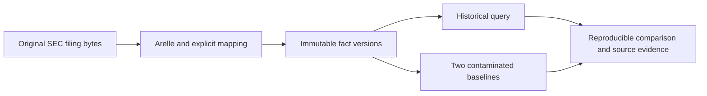
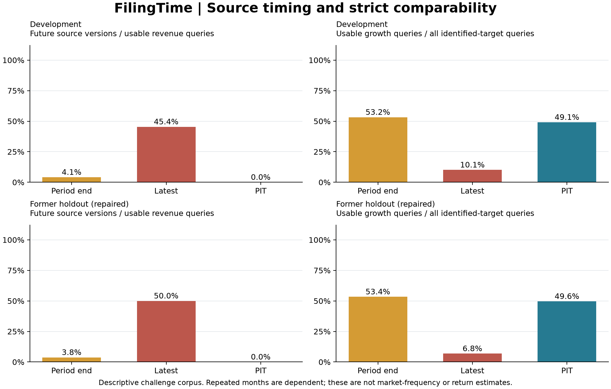

# FilingTime

**Which revenue number was available then?**

FilingTime reconstructs historical annual revenue from original SEC filings and measures how premature disclosure assumptions and later-value backfilling distort a financial feature. Every admitted value keeps a path back to the original document.

[Research report](docs/REPORT.md) · [Real source cases](docs/SOURCE_CASES.md) · [Protocol](docs/PROTOCOL.md) · [中文说明](README.zh-CN.md)

<details>
<summary>Required notices for the unchanged accounting taxonomies included in this work</summary>

**US GAAP Financial Reporting Taxonomy**

<pre>
Notice: Authorized Uses
© 2010-2027 Financial Accounting Foundation; ©
2007-2010 XBRL US, Inc.; © 2020-2027 XBRL US, Inc.  All Rights Reserved.
To
meet the mission requirements of the U.S. Securities and Exchange Commission
(the “Commission”), the US GAAP Financial Reporting Taxonomy[i] (the “Taxonomy”) may be
used by the public, royalty-free, in reporting financial statements under U.S.
generally accepted accounting principles (“GAAP”), and may be
incorporated without change, in whole or in part, in other works (the “Permitted
Works”) that comment on, explain, or assist in the use or
implementation of the Taxonomy. Permitted Works may be copied, published and
distributed by its creator without restriction of any kind imposed hereby; provided,
this Authorized Uses notice is included on the first page thereof. Under no
circumstances may the Taxonomy, or any part of it, be modified in any way, such
as by removing the copyright notice or references to the copyright holder,
except as required to translate it into languages other than English or with
the prior written consent of Financial Accounting Foundation (“FAF”).
Copyright in some of the content available in this Taxonomy belongs to third
parties, including XBRL International, Inc. and XBRL US, Inc. (such third party
content, “Third Party Documents”), and such content has been
produced on this website (and in this Taxonomy) with the permission of the
Third Party Documents copyright holders, including XBRL International, Inc. and XBRL US, Inc. Please check copyright notices on or in respect of
individual Third Party Documents. With respect to XBRL
International, Inc., their Third Party Documents may only be used in accordance
with the terms and conditions of the XBRL International, Inc. Intellectual
Property Policy located at http://www.xbrl.org/Legal2/XBRL-IP-Policy-2007-02-20.pdf (as
the same may be amended from time to time). With respect to XBRL US, Inc.,
their Third Party Documents may only be used in accordance with the terms and
conditions of the XBRL US, Inc. Intellectual Property Policy located at https://xbrl.us/wp-content/uploads/2007/09/ip-policy.pdf  (as the same may be amended from time
to time). The content located at such websites, or in any other copyright
notices for Third Party Document copyright holders is the sole property of such
Third Party Document copyright holder(s) and is provided therein by such Third
Party Document copyright holder(s), &quot;as is&quot; without warranty of any
kind, either express or implied by FAF, and FAF has no responsibility for the
content or obligations therein.
WARRANTY DISCLAIMER
THE
TAXONOMY, THE INFORMATION CONTAINED HEREIN, AND ALL INFORMATION PROVIDED AS
PART OF THIS TAXONOMY AND ITS ASSOCIATED FILES ARE PROVIDED ON AN &quot;AS-IS,
WHERE-IS AND WITH ALL FAULTS&quot; BASIS, AND THE FINANCIAL ACCOUNTING
FOUNDATION, XBRL INTERNATIONAL, INC., AND ALL OTHER COPYRIGHT HOLDERS DISCLAIM
ALL WARRANTIES, EXPRESS OR IMPLIED, INCLUDING BUT NOT LIMITED TO ANY WARRANTY
OF MERCHANTABILITY, FITNESS FOR ANY PARTICULAR PURPOSE, OR TITLE; OR ANY
WARRANTY THAT THE USE OF THE CONTENTS OF THE TAXONOMY OR ITS ASSOCIATED FILES
WILL NOT INFRINGE ANY THIRD PARTY PATENTS, COPYRIGHTS, TRADEMARKS OR OTHER
RIGHTS.
LIMITATION OF LIABILITY
IN
NO EVENT WILL THE FINANCIAL ACCOUNTING FOUNDATION, XBRL INTERNATIONAL, INC., OR
ANY OTHER COPYRIGHT HOLDER BE LIABLE TO ANY USER OR ANY THIRD PARTY FOR THE
COST OF PROCURING SUBSTITUTE GOODS OR SERVICES, LOST PROFITS, LOSS OF USE, LOSS
OF DATA OR ANY DIRECT, INDIRECT, CONSEQUENTIAL, INCIDENTAL, PUNITIVE OR SPECIAL
DAMAGES, WHETHER UNDER CONTRACT, TORT, WARRANTY OR OTHERWISE, ARISING IN ANY
WAY OUT OF THE USE OF THIS TAXONOMY OR ITS ASSOCIATED FILES, OR THE PERFORMANCE
OR IMPLEMENTATION OF THE CONTENTS THEREOF OF ANY TYPE WHATSOEVER, WHETHER OR
NOT SUCH PARTY HAD ADVANCE NOTICE OF THE POSSIBILITY OF SUCH DAMAGES.
[i]
This Taxonomy includes by import the SEC Reporting Taxonomy (the “SRT”).
“Notice: Authorized Uses” for the SRT can be viewed at
http://xbrl.fasb.org/terms/SRT_TermsConditions.html
</pre>

**SEC Reporting Taxonomy**

<pre>
Notice: Authorized Uses
© 2010-2027 Financial Accounting Foundation; © 2007-2010 XBRL
US, Inc.  All Rights Reserved.
To meet the mission requirements of the U.S. Securities and Exchange Commission
(the “Commission”), the SEC Reporting Taxonomy (the “SRT”)
may be used by the public, royalty-free, for reporting purposes in connection
with financial statements under U.S. generally accepted accounting principles
(“GAAP”) or as otherwise provided for by the Commission, and may
be incorporated without change, in whole or in part, in other works (the “Permitted
Works”) that comment on, explain, or assist in the use or
implementation of the SRT. Permitted Works may be copied, published and
distributed by its creator without restriction of any kind imposed hereby; provided,
this Authorized Uses notice is included on the first page thereof. Under no
circumstances may the SRT, or any part of it, be modified in any way, such as
by removing the copyright notice or references to the copyright holder, except
as required to translate it into languages other than English or with the prior
written consent of Financial Accounting Foundation (“FAF”).
Copyright in some of the content available in this SRT belongs to third
parties, including XBRL International, Inc. (such third party content, “Third
Party Documents”), and such content has been produced on this website
(and in this SRT) with the permission of the Third Party Documents copyright
holders, including XBRL International, Inc.. Please check copyright notices on
or in respect of individual Third Party Documents. With respect to XBRL
International, Inc., their Third Party Documents may only be used in accordance
with the terms and conditions of the XBRL International, Inc. Intellectual
Property Policy located at http://www.xbrl.org/Legal2/XBRL-IP-Policy-2007-02-20.pdf (as
the same may be amended from time to time). The content located at such
website, or in any other copyright notices for Third Party Document copyright
holders is the sole property of such Third Party Document copyright holder(s)
and is provided therein by such Third Party Document copyright holder(s),
&quot;as is&quot; without warranty of any kind, either express or implied by
FAF, and FAF has no responsibility for the content or obligations therein.
WARRANTY DISCLAIMER
THE SRT, THE INFORMATION CONTAINED HEREIN, AND ALL INFORMATION PROVIDED AS PART
OF THIS SRT AND ITS ASSOCIATED FILES ARE PROVIDED ON AN &quot;AS-IS, WHERE-IS
AND WITH ALL FAULTS&quot; BASIS, AND THE FINANCIAL ACCOUNTING FOUNDATION, XBRL
INTERNATIONAL, INC., AND ALL OTHER COPYRIGHT HOLDERS DISCLAIM ALL WARRANTIES,
EXPRESS OR IMPLIED, INCLUDING BUT NOT LIMITED TO ANY WARRANTY OF
MERCHANTABILITY, FITNESS FOR ANY PARTICULAR PURPOSE, OR TITLE; OR ANY WARRANTY
THAT THE USE OF THE CONTENTS OF THE SRT OR ITS ASSOCIATED FILES WILL NOT
INFRINGE ANY THIRD PARTY PATENTS, COPYRIGHTS, TRADEMARKS OR OTHER RIGHTS.
LIMITATION OF LIABILITY
IN NO EVENT WILL THE FINANCIAL ACCOUNTING FOUNDATION, XBRL INTERNATIONAL, INC.,
OR ANY OTHER COPYRIGHT HOLDER BE LIABLE TO ANY USER OR ANY THIRD PARTY FOR THE
COST OF PROCURING SUBSTITUTE GOODS OR SERVICES, LOST PROFITS, LOSS OF USE, LOSS
OF DATA OR ANY DIRECT, INDIRECT, CONSEQUENTIAL, INCIDENTAL, PUNITIVE OR SPECIAL
DAMAGES, WHETHER UNDER CONTRACT, TORT, WARRANTY OR OTHERWISE, ARISING IN ANY
WAY OUT OF THE USE OF THIS SRT OR ITS ASSOCIATED FILES, OR THE PERFORMANCE OR
IMPLEMENTATION OF THE CONTENTS THEREOF OF ANY TYPE WHATSOEVER, WHETHER OR NOT
SUCH PARTY HAD ADVANCE NOTICE OF THE POSSIBILITY OF SUCH DAMAGES.
</pre>

</details>

## A small question, investigated end to end

Suppose a later annual report presents a different number for the same historical fiscal year. Using that newer number in an older signal can import information from the future. Even when the number is unchanged, the source version can still be future-dated.

The repository follows one field—**consolidated annual revenue**—through the complete evidence chain:



It covers a fixed **12-company, 72-company-year design**: 8 development issuers and 4 held-out issuers, fiscal years 2019–2024. Source filings extend through the declared 2025 cutoff. Full source/target coverage, including failures, is reported separately from usable query coverage.

## Run a real case in five minutes

Python 3.12+ and [uv](https://docs.astral.sh/uv/) are required. Clone the repository into a location with room for the archived corpus and environment, then:

```console
uv sync --frozen
uv run filingtime verify
uv run filingtime demo
```

The demonstration uses a real filing. At one second before the declared availability boundary, PIT returns no available value. At the boundary, it returns the amount, accession, original source URL, XBRL context, document anchor and source hash. The deliberately contaminated period-end baseline exposes the future source.

```console
uv run filingtime query --cik 0000320193 --period-end 2019-09-28 --as-of 2020-01-31
uv run filingtime query --cik 0000320193 --period-end 2019-09-28 --as-of 2020-01-31 --growth
```

No API key or network request is needed for the bundled queries, experiments or offline replays. The initial environment installation downloads the locked dependencies.

## What is compared

| Mode | Source-version rule | Purpose |
|---|---|---|
| `period_end` | First reported value, made usable at the fiscal period end | Expose premature-information use |
| `latest` | Final collected version, backfilled to first original availability | Expose revision backfilling |
| `pit` | Latest version actually eligible at the query time | Enforce the declared information boundary |

The availability convention is **SEC acceptance plus 24 elapsed hours, in UTC**. It is a research convention, not observed investor receipt time. Earlier earnings announcements and 8-Ks are outside this annual-filing collection.



The [report](docs/REPORT.md) separates future-source use, numeric changes, growth direction changes, coverage, refusals and common-set rank changes. Counts describe repeated queries within this challenge corpus; they are not market-frequency or investment-return estimates.

## Why the accounting details matter

- A revenue-looking number can belong to a segment or an equity-method investee. The Coca-Cola source case shows why selecting the largest amount fails.
- A 10-K/A can amend something other than revenue; an ordinary later 10-K can change a comparative year.
- A later value can reflect discontinued operations or a changed accounting basis. A numerical difference alone is not an accounting error.
- Growth requires a comparable adjacent annual pair in the **same filing**. If a later filing omits the previous year, the query refuses the calculation rather than silently mixing bases.
- Unsupported units, unknown totals, conflicting contexts and unresolved semantics remain explicit refusals.

## Reproduce the evidence

```console
uv run python scripts/reproduce.py --work-dir ./work/reproduction
```

This runs the tests, hashes the original corpus and taxonomy dependencies, checks the rule freeze and complete planned sample, reproduces both experimental result sets in a separate directory, exercises the CLI and Parquet store, re-parses a real filing with network access disabled, and builds/installs the package in a fresh environment. Reference results are never overwritten to make a comparison pass.

Add `--reparse` to replay **all** archived filings through Arelle offline. The full replay takes longer than the default smoke specimen. GitHub Actions runs the default checks on Windows and Linux.

For a fresh source download, set `SEC_USER_AGENT` to an application name and your real contact address, then use `scripts/collect_corpus.py`. The downloader applies throttling, retries and hash-preserving reuse. See the [protocol](docs/PROTOCOL.md) before collecting or changing the sample.

## What the evidence proves

| Evidence | What it establishes |
|---|---|
| Original documents, contexts and hashes | The exact source bytes and location used |
| Independent AI checks of original statement tables | A separate source-reading path for selected examples |
| Property tests and labeled fault injections | Specific temporal and semantic failure modes |
| Frozen rules and held-out issuers | The stated development/evaluation separation |
| Clean replay and cross-platform CI | Computational reproducibility on the tested environments |

**Independent human accounting review is pending.** AI source checks are labeled as AI work; no human accuracy rate or audit certification is claimed. The [review template](docs/SOURCE_REVIEW_TEMPLATE.md) and saved source checks make an external review possible.

## Repository map

| Path | Contents |
|---|---|
| `src/filingtime/` | Collection, Arelle extraction, mapping, temporal engine, Parquet store, experiments and CLI |
| `data/raw/` | Compressed original filings, metadata and unchanged taxonomy dependencies |
| `data/manifests/` | Source hashes, parsing audits, frozen rules and dependency provenance |
| `data/reference/` | Explicitly attributed source checks |
| `data/processed/` | Normalized facts, target periods and immutable Parquet batches |
| `data/results/` | Reproducible observations, rankings, summaries and synthetic fault results |
| `docs/` | Protocol, report, source cases, review guide and limitations |
| `tests/` | Temporal invariants, adversarial accounting cases and reproduction checks |

Original project code is MIT licensed. Filings, taxonomy bytes and vendored components keep their own terms; see [third-party notices](docs/THIRD_PARTY_NOTICES.md). This project is not endorsed by the SEC, FASB or Arelle.
